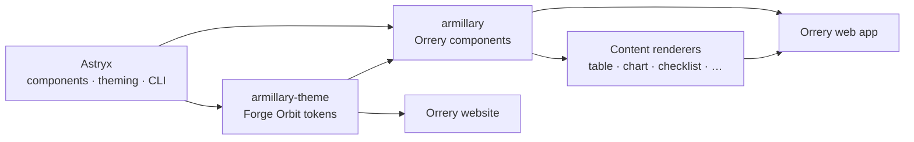

  <picture>
    <source media="(prefers-color-scheme: dark)" srcset="assets/armillary-mark-dark.svg">
    
  </picture>

<h1 align="center">Armillary</h1>

  <strong>The design system for <a href="https://github.com/forge-orbit/orrery">Orrery</a>, built on <a href="https://github.com/meta/astryx">Astryx</a>.</strong> 
  One theme, one set of components and one way to render agent output, shared by people and AI agents.

  <em>Status: design phase. Nothing to install yet; no packages are published.</em>

  <a href="https://github.com/forge-orbit/orrery">Orrery</a> ·
  <a href="https://astryx.atmeta.com">Astryx docs</a> ·
  <a href="https://forge-orbit.github.io/orrery-site/">Website</a> ·
  <a href="https://github.com/forge-orbit/orrery/labels/need%20discussion">Open questions</a>

---

## Why Armillary

[Orrery](https://github.com/forge-orbit/orrery) is self-hosted project management for teams of
humans **and** AI agents. Its screens show work done by both: boards, issues, agent sessions, a
needs-input inbox and a shared Markdown vault. We're building the design system **before** the
product UI, so every screen shares one visual language and one set of parts from day one.

Armillary also has a second audience: **agents.** In Orrery, agents write progress reports,
review summaries and questions that the UI renders as tables, charts and forms. Armillary
defines those building blocks once, with documented schemas, so an agent and a person produce
the same result.

> An **armillary sphere** is a frame of rings modeling the coordinate grid of the sky, the
> sibling instrument of an orrery. A design system is the frame every screen is built on.

## How it fits together

Armillary builds **on** Astryx; it doesn't fork or re-implement it. Astryx provides the
accessible primitives, theming and tooling. Armillary adds Forge Orbit's brand and the
components specific to Orrery.

## What's planned

Everything below is a proposal. Package names are placeholders.

| Package (planned) | What it contains |
| --- | --- |
| `@forge-orbit/armillary-theme` | Forge Orbit's palette, type, spacing and radii as Astryx CSS-variable overrides; light first, with a dark mode |
| `@forge-orbit/armillary` | Orrery components composed from Astryx: issue cards, board columns, agent session rows and status badges, the needs-input answer form, vault doc views |
| `@forge-orbit/armillary` renderers | Blocks agents use in comments and reports: table, chart, checklist, key-value, test results, Mermaid |

The renderers follow the plugin-ready rules proposed in
[orrery#15](https://github.com/forge-orbit/orrery/issues/15):
- blocks are stored as source
- each block type has a versioned schema
- renderers come from a registry, so plugins can add more later
- unknown blocks fall back to a readable code block

## Principles

- **Theme, don't fork.** Brand changes are CSS-variable overrides on Astryx, never patched component source.
- **One accent.** Warm paper, dark ink, and a single orange accent. Orange marks what needs attention.
- **Agent-ready.** Every component and block is documented well enough for an agent to use it correctly, with schemas where agents produce data.
- **Accessible by default.** We keep Astryx's accessibility guarantees and test new components the same way.

## Brand

### Logo

The mark is a lowercase **a** built from a ring and a rounded bar, with the orange sun at its
center. It shares the Orrery mark's vocabulary of rounded bars and one orange dot, so the two
read as one family.

  
  
  
  

| File (SVG and PNG in [`assets/`](assets/)) | Use |
| --- | --- |
| `armillary-mark` / `armillary-mark-dark` | Tightly cropped, for READMEs and headers |
| `armillary-color-transparent` / `-transparent-dark` | Full-color mark on a transparent 512×512 canvas |
| `armillary-color-light` / `armillary-color-dark` | Full color on a background, for avatars and social images |
| `armillary-black-*` / `armillary-white-*` | One-color versions for print, embossing or single-color contexts |

Keep the orange dot orange in color versions, leave clear space around the mark of at least the
dot's diameter, and don't use the mark below 16 px.

### Tokens

| Token | Value |
| --- | --- |
| Ink | `#14161B` |
| Cream | `#F6F3EC` |
| Night (dark background) | `#0B0F17` |
| Accent | `#F2561D` |
| Headings | Instrument Serif |
| Text | Inter |
| Code | JetBrains Mono |

## Roadmap

- [ ] Theme tokens as Astryx overrides, light and dark
- [ ] Core Orrery components: issue card, board column, session row, status badge
- [ ] Content renderers with versioned schemas
- [ ] Docs and a live preview (Storybook or Astryx's docs tooling)
- [ ] First release consumed by Orrery's web app

## Contributing

Nothing is decided yet, and the best way to help is to join the discussion. Open an issue here,
or in [forge-orbit/orrery](https://github.com/forge-orbit/orrery) labeled
[`need discussion`](https://github.com/forge-orbit/orrery/labels/need%20discussion). Changes go
through pull requests; `main` is protected.

## License

MIT. See [LICENSE](LICENSE).

Astryx is Copyright (c) 2026 Meta Platforms, Inc., released under the MIT license. Armillary is
an independent project by Forge Orbit and is not affiliated with or endorsed by Meta.

---

Built by <a href="https://github.com/forge-orbit">Forge Orbit</a>

